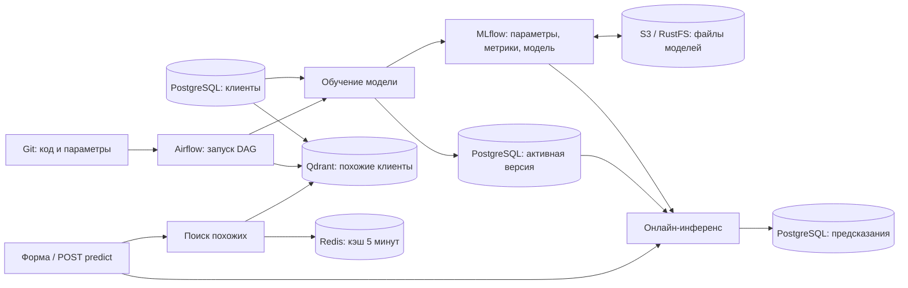

# ML-сервис: Git → Airflow → PostgreSQL → MLflow → онлайн-инференс

Учебный сервис прогноза оттока клиентов. Небольшой Random Forest обучается на синтетических данных и используется в настоящих HTTP-предсказаниях. Основная цель — увидеть полный процесс в интерфейсах.

## Запуск

Нужны Git и Docker Desktop с Linux-контейнерами. Из каталога клонированного репозитория:

```powershell
docker compose up -d --build
docker compose logs --tail 30 airflow
docker compose exec airflow cat /opt/airflow/simple_auth_manager_passwords.json.generated
```

Последняя команда показывает пароль Airflow, логин `admin`. При первом старте пароль появляется после инициализации. Первая сборка скачивает образы и зависимости и может занять несколько минут.

| Компонент | Адрес | Что показать |
|---|---|---|
| Сервис | http://localhost:8000 | Форма прогноза, вероятность, версия модели и commit |
| Airflow | http://localhost:8080 | Граф, запуск, статусы и логи |
| MLflow | http://localhost:5000 | Эксперимент `churn-online-demo`, параметры, метрики, модель |
| S3 / RustFS | http://localhost:9001 | Bucket `mlflow-artifacts` и настоящие файлы моделей |
| PostgreSQL / Adminer | http://localhost:8081 | Таблицы клиентов, моделей и предсказаний |
| Qdrant | http://localhost:6333/dashboard | Коллекция `customers_synthetic_v1`, 1200 клиентов и их векторы |
| Redis Insight | http://localhost:5540 | Ключи кэша повторного поиска, TTL и команды Redis |
| API | http://localhost:8000/docs | `POST /predict` и `POST /neighbors` прямо из браузера |

В Adminer выбрать **PostgreSQL**, сервер `postgres`, пользователь `demo`, пароль `demo_local`, база `demo`, схема `app`. Это учебные реквизиты. Порты интерфейсов привязаны к localhost; PostgreSQL доступен внутри сети Compose.

В Airflow снять паузу с `demo_04_train_and_publish`, нажать Trigger и дождаться успеха. Затем открыть сервис и нажать «Получить прогноз». До первого обучения `/model` и `/predict` возвращают 503 с объяснением.

## Как всё связано



Шаги DAG-а: `prepare_data → index_customers → train_and_log → publish_model → verify_online_prediction`.

- Подготовка создаёт 1200 воспроизводимых клиентов; повторный запуск не дублирует строки.
- Индексация переводит три признака клиента в числовой вектор и сохраняет его в Qdrant. Отдельный `qdrant-init` готовит коллекцию при первом запуске стенда, поэтому поиск работает и до нового запуска DAG.
- Обучение читает PostgreSQL, делит данные на train/holdout и обучает модель. MLflow получает ROC AUC, accuracy, параметры, Git commit, признак незакоммиченных изменений, Airflow run ID, конфигурацию и исходник обучения.
- Публикация сохраняет модель в `app.model_runs` и меняет указатель `app.active_model` одной транзакцией.
- Онлайн-сервис сверяет этот указатель с MLflow Model Registry и помечает рабочую версию alias `production`. В MLflow откройте **Models → churn-prediction**: нужная версия видна без поиска по длинному model ID. Alias обновляется после смены активной модели.
- Последняя задача отправляет реальный HTTP-запрос сервису и проверяет, что он использует именно опубликованный MLflow run ID.
- Сервис перед запросом проверяет активную версию. Новую модель загружает из MLflow, затем держит в памяти. Каждый прогноз записывается в `app.predictions`.

## Поиск похожих клиентов и кэш

На главной странице сервиса введите признаки клиента и дважды нажмите **Найти похожих**.
Первый запрос `/neighbors` ищет пять ближайших исторических клиентов в Qdrant,
второй читает тот же результат из Redis. Ответ явно показывает `cache_hit` и
`cache_status`. Если поменять признаки, получится новый запрос к Qdrant.
Кэш хранится 5 минут и не сохраняется на диск; при остановке Redis поиск
продолжает работать через Qdrant, в ответе будет `cache_status: unavailable`.

В Qdrant откройте коллекцию `customers_synthetic_v1` и покажите 1200 точек:
у каждой есть три нормированных признака для поиска и обычные поля в payload.
Исторический отток в payload — метка учебного клиента, а не прогноз модели.
Qdrant не хранит файлы моделей: они остаются в S3. Redis Insight автоматически
подключён к Redis; в Browser найдите ключи `neighbors:v1:*` и посмотрите TTL.
Чтобы увидеть новый ключ, повторите поиск на странице сервиса и обновите Redis Insight.
При необходимости проверить кэш в консоли:

```powershell
docker compose exec redis redis-cli --scan --pattern 'neighbors:v1:*'
```

MLflow хранит метаданные в PostgreSQL в схеме `public`, учебные таблицы находятся в `app`. Файлы моделей хранятся в S3-совместимом RustFS и передаются через MLflow. Сам RustFS сохраняет объекты в Docker volume `ml-airflow-demo_s3-data`. Airflow для компактности использует свою локальную базу в volume.

## Файлы моделей в S3

Открыть http://localhost:9001. Access key / логин: `demo_s3`, Secret key / пароль: `demo_s3_password`. Выбрать bucket **mlflow-artifacts**, затем `1 → models → <model-id> → artifacts`. Здесь лежат `model.pkl`, `MLmodel`, описание зависимостей и пример входных данных. Порт 9000 — S3 API, порт 9001 — веб-консоль.

Маршрут записи: **задача Airflow → MLflow → S3**. Маршрут загрузки: **сервис → MLflow → S3**. Доступ к S3 настроен у MLflow; задачам обучения и сервису отдельные ключи не нужны. Поэтому MLflow продолжает показывать URI вида `mlflow-artifacts:/...`, хотя физически файлы лежат в `s3://mlflow-artifacts/...`.

При запуске `s3-init` создаёт bucket и копирует старые файлы из прежнего volume, проверяя SHA-256. Исходные файлы сохраняются; повторный запуск проверяет уже скопированные объекты. Перезапись несовпадающего объекта запрещена. Существующие model ID и ссылки сохраняются. MLflow стартует только после успешной подготовки хранилища.

Для проверки сохранённых моделей:

```powershell
docker compose exec mlflow python scripts/verify_s3.py
```

Проверка сравнивает байты `model.pkl` в S3 с загрузкой через MLflow и выполняет предсказание каждой сохранённой моделью. Старый volume `mlflow-artifacts` — резервная копия до перехода, новые модели туда не записываются. Чтобы скачать текущую модель, можно выбрать `model.pkl` в S3-консоли; для загрузки всего MLflow-пакета использовать `mlflow.artifacts.download_artifacts` с её `models:/<model-id>` URI.

## Сценарий демонстрации на 20–25 минут

1. **GitHub.** Показать `service/app.py`, `src/pipeline.py`, `dags/churn_service.py`, `model_config.json`.
2. **Airflow.** Запустить DAG 04, открыть граф и логи, показать этап `index_customers`, зависимости и статусы. В XCom только небольшие результаты и идентификаторы; данные остаются в PostgreSQL и Qdrant.
3. **PostgreSQL.** В схеме `app` открыть `customers`, `model_runs`, `active_model`, найти идентификатор обучения.
4. **MLflow и S3.** Открыть **Models → churn-prediction** и показать версию с alias `production`. Затем открыть её запуск в `churn-online-demo`, параметры, holdout-метрики, теги `git_commit` и `airflow_run_id`. Скопировать model ID и найти соответствующую папку в bucket `mlflow-artifacts` в RustFS. Показать сам файл `model.pkl`.
5. **Инференс и поиск.** Отправить несколько запросов через форму, меняя число обращений в поддержку. Дважды нажать «Найти похожих»: первый ответ от Qdrant, второй из Redis. Показать `/docs`, затем новые строки `app.predictions`.
6. **Изменение из GitHub.** Отдельным коммитом поменять `max_depth` с 8 на 12 в `model_config.json`, получить изменения локально и снова запустить DAG. Сравнить два запуска в MLflow; в сервисе показать новый commit и run ID.
7. **Ошибки и retries.** При необходимости перейти к DAG-ам 01–03: подробный сценарий в [AIRFLOW_GUIDE.md](AIRFLOW_GUIDE.md).

## GitHub и обновление кода

Автоматическая сборка, проверка полного стенда и развёртывание через GitHub Actions описаны в [CI_CD.md](CI_CD.md). Платформа и ML-сервис имеют отдельные образы: push обновляет только `inference` и `traffic`, подключённые к уже работающим Airflow, MLflow и хранилищам. После перехода на CD код работает из образа; инструкция ниже с `git pull` относится к исходному режиму разработки с bind mounts.

Первый запуск на другой машине: `git clone <URL-репозитория>`, перейти в папку и выполнить команды Compose выше. Для текущей папки remote добавляется при публикации репозитория.

Для демонстрации отредактировать **только `model_config.json`** в GitHub и создать commit в `main`. Дождаться завершения текущего DAG-а и выполнить:

```powershell
git pull --ff-only
git log -1 --oneline
```

Конфигурация читается при каждом обучении, пересборка для неё не нужна. Airflow подхватывает обновлённые DAG-и при следующем разборе файлов. После изменения кода HTTP-сервиса выполнить `docker compose restart inference`; после изменения зависимостей — `docker compose up -d --build`.

В стенде изменения доставляются явным `git pull`, а не автоматически из GitHub. Не делать pull во время активного DAG-а: код не должен меняться посреди запуска. Незакоммиченные изменения отмечаются `git_dirty=true` в MLflow, поэтому один commit в таком случае не описывает всё рабочее дерево.

## Запрос из PowerShell

```powershell
$body = @{ tenure_months = 6; monthly_spend = 120; support_tickets = 5 } | ConvertTo-Json
Invoke-RestMethod http://localhost:8000/predict -Method Post -ContentType 'application/json' -Body $body
```

В ответе: вероятность, класс с порогом 0.5, MLflow run ID, Git commit, Airflow run ID и holdout ROC AUC. `GET /health` проверяет сервис и БД, `GET /model` — наличие активной модели.

SQL для просмотра цепочки:

```sql
SELECT p.id, p.probability, p.features, r.git_commit, r.airflow_run_id,
       p.mlflow_run_id, p.created_at
FROM app.predictions p
JOIN app.model_runs r USING (mlflow_run_id)
ORDER BY p.id DESC LIMIT 20;
```

## Остановка

Для проверки всех четырёх DAG-ов: `docker compose exec airflow python scripts/verify_demo.py`. Команда создаёт настоящие запуски, выполняет retry и Clear, затем проверяет инференс и строки в PostgreSQL. Проверка занимает несколько минут и оставляет историю для показа.

`docker compose stop` — остановка, `docker compose start` — повторный запуск.
`docker compose down` удаляет контейнеры и сеть, сохраняя volumes; после него использовать `docker compose up -d`. Не добавлять `-v`, если нужна история, модели и данные.

Это учебная автоматическая публикация каждой успешно обученной модели без отбора по качеству. Сравнение экспериментов показывается вручную. Три признака, небольшие данные и один процесс сервиса выбраны ради наглядности.

## Источники

- [Airflow: локальный запуск](https://airflow.apache.org/docs/apache-airflow/3.3.2/start.html)
- [Airflow: состояния задач](https://airflow.apache.org/docs/apache-airflow/3.3.2/core-concepts/tasks.html)
- [MLflow: tracking server](https://mlflow.org/docs/latest/self-hosting/architecture/tracking-server/)
- [MLflow: backend store](https://mlflow.org/docs/latest/self-hosting/architecture/backend-store/)
- [MLflow: S3 artifact store](https://mlflow.org/docs/latest/self-hosting/architecture/artifact-store/)
- [RustFS: запуск в Docker](https://docs.rustfs.com/en/installation/container/docker)
# Мониторинг модели: Prometheus + Grafana

- Grafana: http://localhost:3000/d/ml-model-overview — `admin` / `demo_grafana`.
- Prometheus: http://localhost:9090 — страница Targets показывает сбор метрик с inference.
- Исходные метрики: http://localhost:8000/metrics.

Дашборд создаётся автоматически: запросы/сек по HTTP-статусу, p50/p95 задержки,
ошибки 4xx/5xx, распределение вероятностей оттока, доля класса 1, средние входные
признаки, опубликованная версия модели, время публикации и offline ROC AUC.
ROC AUC берётся из PostgreSQL после обучения; это не оценка качества на живом трафике.
Для online quality нужны фактические ответы пользователей. Сдвиг входных признаков
или прогнозов сам по себе не доказывает ухудшение качества.

Сервис `traffic` постоянно отправляет новый синтетический запрос примерно каждые
4 секунды. Он чередует обычных клиентов и клиентов с высоким риском каждые 3 минуты,
поэтому на графиках меняются признаки и прогнозы. Каждый двадцатый запрос
намеренно невалиден (422). Поток запускается автоматически вместе со стеком и
возобновляется после перезапуска Docker. Данные поступают, пока работают Docker
Desktop и контейнеры. После запуска откройте Grafana и выберите последние 15 минут.

Управление потоком из каталога репозитория:

```powershell
docker compose stop traffic
docker compose start traffic
docker compose logs -f traffic
```

Можно также вручную показать два профиля быстрее, не ожидая смены фазы:

```powershell
docker compose exec -T inference python scripts/demo_traffic.py --seconds 120 --scenario normal
docker compose exec -T inference python scripts/demo_traffic.py --seconds 120 --scenario high-risk
```

Первый ручной запуск создаёт обычные синтетические запросы, второй — клиентов с
небольшим стажем и большим числом обращений. Успешные прогнозы сохраняются в
`app.predictions`; постоянный поток добавляет примерно 20 тысяч строк в сутки.
При длительной работе стенда это увеличивает объём PostgreSQL. Ручной генератор
завершается через указанное время. Запросы можно отправлять и через
http://localhost:8000.

Prometheus опрашивает API каждые 5 секунд, история хранится 15 дней в отдельном
volume. Grafana хранит настройки в своём volume; конфигурация datasource и dashboard
версионируется в `monitoring/` и доставляется через CI/CD. Счётчики API сбрасываются
после перезапуска процесса; запросы `rate` учитывают сброс. Старые строки из БД не
превращаются задним числом в временные ряды. Без трафика некоторые панели пустые.
Метрики запросов агрегированы по всем версиям; версия модели показана отдельно.
Инструментация рассчитана на текущий один процесс uvicorn.

Проверка: `docker compose exec -T inference python scripts/verify_monitoring.py`.
CI и CD запускают её и `scripts/verify_traffic.py` автоматически: HTTP-метрики, модель/AUC, scrape Prometheus,
datasource Grafana и все запросы панелей. Проверка создаёт один успешный прогноз
и один запрос с ошибкой валидации. Автоматическая рассылка оповещений пока не настроена.
Демонстрационные учётные данные подходят только для локального стенда.
