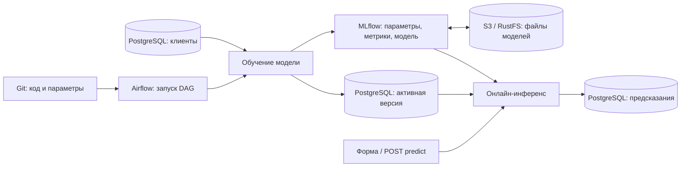

# ML-сервис: Git → Airflow → PostgreSQL → MLflow → онлайн-инференс

Учебный сервис прогноза оттока клиентов. Небольшой Random Forest обучается на синтетических данных и используется в настоящих HTTP-предсказаниях. Основная цель — увидеть полный процесс в интерфейсах.

## Запуск

Нужны Git и Docker Desktop с Linux-контейнерами. Из каталога клонированного репозитория:

```powershell
docker compose up -d --build
docker compose logs --tail 30 airflow
docker compose exec airflow cat /opt/airflow/simple_auth_manager_passwords.json.generated
```

Последняя команда показывает пароль Airflow, логин `admin`. При первом старте пароль появляется после инициализации. Первая сборка скачивает образы и зависимости и может занять несколько минут.

| Компонент | Адрес | Что показать |
|---|---|---|
| Сервис | http://localhost:8000 | Форма прогноза, вероятность, версия модели и commit |
| Airflow | http://localhost:8080 | Граф, запуск, статусы и логи |
| MLflow | http://localhost:5000 | Эксперимент `churn-online-demo`, параметры, метрики, модель |
| S3 / RustFS | http://localhost:9001 | Bucket `mlflow-artifacts` и настоящие файлы моделей |
| PostgreSQL / Adminer | http://localhost:8081 | Таблицы клиентов, моделей и предсказаний |
| API | http://localhost:8000/docs | `POST /predict` прямо из браузера |

В Adminer выбрать **PostgreSQL**, сервер `postgres`, пользователь `demo`, пароль `demo_local`, база `demo`, схема `app`. Это учебные реквизиты. Порты интерфейсов привязаны к localhost; PostgreSQL доступен внутри сети Compose.

В Airflow снять паузу с `demo_04_train_and_publish`, нажать Trigger и дождаться успеха. Затем открыть сервис и нажать «Получить прогноз». До первого обучения `/model` и `/predict` возвращают 503 с объяснением.

## Как всё связано



Шаги DAG-а: `prepare_data → train_and_log → publish_model → verify_online_prediction`.

- Подготовка создаёт 1200 воспроизводимых клиентов; повторный запуск не дублирует строки.
- Обучение читает PostgreSQL, делит данные на train/holdout и обучает модель. MLflow получает ROC AUC, accuracy, параметры, Git commit, признак незакоммиченных изменений, Airflow run ID, конфигурацию и исходник обучения.
- Публикация сохраняет модель в `app.model_runs` и меняет указатель `app.active_model` одной транзакцией.
- Последняя задача отправляет реальный HTTP-запрос сервису и проверяет, что он использует именно опубликованный MLflow run ID.
- Сервис перед запросом проверяет активную версию. Новую модель загружает из MLflow, затем держит в памяти. Каждый прогноз записывается в `app.predictions`.

MLflow хранит метаданные в PostgreSQL в схеме `public`, учебные таблицы находятся в `app`. Файлы моделей хранятся в S3-совместимом RustFS и передаются через MLflow. Сам RustFS сохраняет объекты в Docker volume `ml-airflow-demo_s3-data`. Airflow для компактности использует свою локальную базу в volume.

## Файлы моделей в S3

Открыть http://localhost:9001. Access key / логин: `demo_s3`, Secret key / пароль: `demo_s3_password`. Выбрать bucket **mlflow-artifacts**, затем `1 → models → <model-id> → artifacts`. Здесь лежат `model.pkl`, `MLmodel`, описание зависимостей и пример входных данных. Порт 9000 — S3 API, порт 9001 — веб-консоль.

Маршрут записи: **задача Airflow → MLflow → S3**. Маршрут загрузки: **сервис → MLflow → S3**. Доступ к S3 настроен у MLflow; задачам обучения и сервису отдельные ключи не нужны. Поэтому MLflow продолжает показывать URI вида `mlflow-artifacts:/...`, хотя физически файлы лежат в `s3://mlflow-artifacts/...`.

При запуске `s3-init` создаёт bucket и копирует старые файлы из прежнего volume, проверяя SHA-256. Исходные файлы сохраняются; повторный запуск проверяет уже скопированные объекты. Перезапись несовпадающего объекта запрещена. Существующие model ID и ссылки сохраняются. MLflow стартует только после успешной подготовки хранилища.

Для проверки сохранённых моделей:

```powershell
docker compose exec mlflow python scripts/verify_s3.py
```

Проверка сравнивает байты `model.pkl` в S3 с загрузкой через MLflow и выполняет предсказание каждой сохранённой моделью. Старый volume `mlflow-artifacts` — резервная копия до перехода, новые модели туда не записываются. Чтобы скачать текущую модель, можно выбрать `model.pkl` в S3-консоли; для загрузки всего MLflow-пакета использовать `mlflow.artifacts.download_artifacts` с её `models:/<model-id>` URI.

## Сценарий демонстрации на 20–25 минут

1. **GitHub.** Показать `service/app.py`, `src/pipeline.py`, `dags/churn_service.py`, `model_config.json`.
2. **Airflow.** Запустить DAG 04, открыть граф и логи, показать зависимости и статусы. В XCom только небольшие результаты и идентификаторы; данные остаются в PostgreSQL.
3. **PostgreSQL.** В схеме `app` открыть `customers`, `model_runs`, `active_model`, найти идентификатор обучения.
4. **MLflow и S3.** Открыть `churn-online-demo`, параметры, holdout-метрики, теги `git_commit` и `airflow_run_id`, вкладку Models. Скопировать model ID и найти соответствующую папку в bucket `mlflow-artifacts` в RustFS. Показать сам файл `model.pkl`.
5. **Инференс.** Отправить несколько запросов через форму, меняя число обращений в поддержку. Показать `/docs`, затем новые строки `app.predictions`.
6. **Изменение из GitHub.** Отдельным коммитом поменять `max_depth` с 8 на 12 в `model_config.json`, получить изменения локально и снова запустить DAG. Сравнить два запуска в MLflow; в сервисе показать новый commit и run ID.
7. **Ошибки и retries.** При необходимости перейти к DAG-ам 01–03: подробный сценарий в [AIRFLOW_GUIDE.md](AIRFLOW_GUIDE.md).

## GitHub и обновление кода

Автоматическая сборка, проверка полного стенда и развёртывание через GitHub Actions описаны в [CI_CD.md](CI_CD.md). После перехода на CD код работает из образа; инструкция ниже с `git pull` относится к исходному режиму разработки с bind mounts.

Первый запуск на другой машине: `git clone <URL-репозитория>`, перейти в папку и выполнить команды Compose выше. Для текущей папки remote добавляется при публикации репозитория.

Для демонстрации отредактировать **только `model_config.json`** в GitHub и создать commit в `main`. Дождаться завершения текущего DAG-а и выполнить:

```powershell
git pull --ff-only
git log -1 --oneline
```

Конфигурация читается при каждом обучении, пересборка для неё не нужна. Airflow подхватывает обновлённые DAG-и при следующем разборе файлов. После изменения кода HTTP-сервиса выполнить `docker compose restart inference`; после изменения зависимостей — `docker compose up -d --build`.

В стенде изменения доставляются явным `git pull`, а не автоматически из GitHub. Не делать pull во время активного DAG-а: код не должен меняться посреди запуска. Незакоммиченные изменения отмечаются `git_dirty=true` в MLflow, поэтому один commit в таком случае не описывает всё рабочее дерево.

## Запрос из PowerShell

```powershell
$body = @{ tenure_months = 6; monthly_spend = 120; support_tickets = 5 } | ConvertTo-Json
Invoke-RestMethod http://localhost:8000/predict -Method Post -ContentType 'application/json' -Body $body
```

В ответе: вероятность, класс с порогом 0.5, MLflow run ID, Git commit, Airflow run ID и holdout ROC AUC. `GET /health` проверяет сервис и БД, `GET /model` — наличие активной модели.

SQL для просмотра цепочки:

```sql
SELECT p.id, p.probability, p.features, r.git_commit, r.airflow_run_id,
       p.mlflow_run_id, p.created_at
FROM app.predictions p
JOIN app.model_runs r USING (mlflow_run_id)
ORDER BY p.id DESC LIMIT 20;
```

## Остановка

Для проверки всех четырёх DAG-ов: `docker compose exec airflow python scripts/verify_demo.py`. Команда создаёт настоящие запуски, выполняет retry и Clear, затем проверяет инференс и строки в PostgreSQL. Проверка занимает несколько минут и оставляет историю для показа.

`docker compose stop` — остановка, `docker compose start` — повторный запуск.
`docker compose down` удаляет контейнеры и сеть, сохраняя volumes; после него использовать `docker compose up -d`. Не добавлять `-v`, если нужна история, модели и данные.

Это учебная автоматическая публикация каждой успешно обученной модели без отбора по качеству. Сравнение экспериментов показывается вручную. Три признака, небольшие данные и один процесс сервиса выбраны ради наглядности.

## Источники

- [Airflow: локальный запуск](https://airflow.apache.org/docs/apache-airflow/3.3.2/start.html)
- [Airflow: состояния задач](https://airflow.apache.org/docs/apache-airflow/3.3.2/core-concepts/tasks.html)
- [MLflow: tracking server](https://mlflow.org/docs/latest/self-hosting/architecture/tracking-server/)
- [MLflow: backend store](https://mlflow.org/docs/latest/self-hosting/architecture/backend-store/)
- [MLflow: S3 artifact store](https://mlflow.org/docs/latest/self-hosting/architecture/artifact-store/)
- [RustFS: запуск в Docker](https://docs.rustfs.com/en/installation/container/docker)
