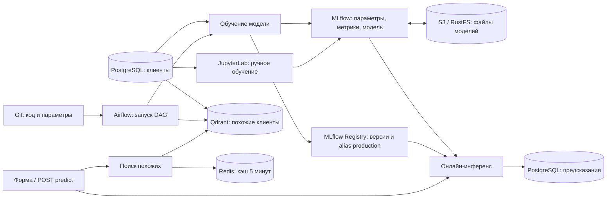

# Учебная ML-платформа: от ноутбука до прогноза

Локальный стенд: PostgreSQL → JupyterLab / Airflow → MLflow → S3 → HTTP-сервис. Данные синтетические; модели и файлы с компьютера автора не нужны.

**Начните с шагов 1–7.** Для них не нужны Python на компьютере, GitHub Actions, runner или доступ к GHCR. CI/CD — отдельное продолжение в [CI_CD.md](CI_CD.md). Подробности компонентов находятся после инструкции, сценарий показа — в [GUIDE_DEMO.md](GUIDE_DEMO.md).

## 1. Подготовить компьютер

Установите Git и Docker Desktop с Linux-контейнерами; на Linux можно использовать Docker Engine с современным Docker Compose (команда `docker compose`). Запустите Docker. Нужен интернет для скачивания репозитория, образов и пакетов. Проверьте свободное место на диске Docker: образы и volumes занимают место вне папки репозитория. Минимальный объём RAM/диска не измерен, ARM/macOS отдельно не проверялись.

```text
git --version
docker version
docker compose version
```

**Проверка:** Docker показывает Client и Server, команда `docker compose version` выполняется успешно (эта инструкция проверена с Compose 5.5.1). Если daemon недоступен, сначала запустите Docker.

## 2. Скачать и зафиксировать версию

Из любой удобной родительской папки:

```text
git clone https://github.com/sergey445512/airflow-ml-service-demo.git ml-platform-demo
cd ml-platform-demo
git rev-parse HEAD
git status --short
```

Если репозиторий приватный, владелец должен выдать доступ. Сохраните SHA из `git rev-parse HEAD`. Для повторения конкретной версии гайда до сборки выполните `git checkout <SHA-из-гайда>`, подставив настоящий SHA.

**Проверка:** здесь есть `compose.yaml`, `Dockerfile`, `notebooks/`, `dags/`, а сразу после клонирования `git status --short` пуст. Все дальнейшие команды выполняются из этой папки. Фиксированный путь на диске и `.env` не нужны. Зависимости перечислены в `Dockerfile*`.

## 3. Собрать образы

Выполняйте по очереди; при ошибке не переходите дальше:

```text
docker compose config --quiet
docker compose build inference-blue
docker compose build airflow
docker compose build jupyterlab architecture-map inference
```

ML-образ собирается первым: JupyterLab использует его как базу с совместимыми библиотеками. Образ Airflow используется также MLflow и задачами инициализации. Вторая копия ML-сервиса использует тот же локальный образ.

**Проверка:** все команды завершились с кодом 0. Не заменяйте закреплённые версии на `latest` при ошибках скачивания: сначала проверьте доступ к registry и интернет.

Используйте оболочку без ранее заданных `PLATFORM_IMAGE`, `AIRFLOW_IMAGE`, `SERVICE_IMAGE`, `BLUE_IMAGE`, `GREEN_IMAGE`, `JUPYTER_IMAGE`, `MAP_IMAGE`, `GATEWAY_IMAGE`: они переопределяют локальные образы. Итоговый набор показывает `docker compose config --images`.

## 4. Запустить и проверить готовность

```text
docker compose up -d --no-build --wait --wait-timeout 600
docker compose ps -a
docker compose logs --tail 40 airflow
```

При первом запуске автоматически создаются 1200 клиентов в PostgreSQL, bucket S3 и коллекция Qdrant. Инициализация может занять несколько минут.

**Проверка:** долгоживущие сервисы работают; имеющие healthcheck переходят в `healthy`. Задачи `postgres-seed`, `s3-init`, `qdrant-init`, `redisinsight-init` должны завершиться с `Exited (0)` — это нормально. У Airflow нет Compose healthcheck: отдельно дождитесь страницы http://localhost:8080 и появления DAG-ов.

Откройте карту и ML-сервис. До обучения и выбора production-модели ответы 503 на `/model` и `/churn/predict` ожидаемы. Успех `/health` означает готовность сервиса и БД, но не наличие модели.

| Инструмент | Адрес | Вход |
|---|---|---|
| ML-сервис / API | http://localhost:8000 / http://localhost:8000/docs | Без входа |
| Карта | http://localhost:8090 | Без входа |
| JupyterLab | http://localhost:8888/lab?token=demo_lab | Токен `demo_lab` |
| MLflow | http://localhost:5000 | Без входа |
| Airflow | http://localhost:8080 | `admin`, пароль командой ниже |
| S3 / RustFS | http://localhost:9001 | `demo_s3` / `demo_s3_password` |
| Adminer | http://localhost:8081 | PostgreSQL, сервер `postgres`, база `demo`, `demo` / `demo_local` |
| Grafana | http://localhost:3000 | `admin` / `demo_grafana` |
| Prometheus | http://localhost:9090 | Без входа |
| Qdrant | http://localhost:6333/dashboard | Без входа |
| Redis Insight | http://localhost:5540 | Redis подключается автоматически |

```text
docker compose exec airflow cat /opt/airflow/simple_auth_manager_passwords.json.generated
```

Пароль Airflow появляется после инициализации. Для DBeaver: host `127.0.0.1`, port `5433`, database `demo`, user `demo`, password `demo_local`, schema `app`. В браузере используйте `localhost`; имена `mlflow`, `postgres`, `s3` работают внутри Docker. Эти учётные данные и привязка портов к localhost предназначены для локального занятия.

## 5. Обучить и выбрать первую модель

1. В JupyterLab откройте `01_train_churn_model.ipynb` и выполните ячейки сверху вниз. Сохранённый вывод — пример прошлого запуска, он не создаёт модель на вашем компьютере.
2. Ноутбук читает PostgreSQL, обучает логистическую регрессию и регистрирует кандидата в MLflow. Дождитесь выполнения всех ячеек без ошибок.
3. В MLflow откройте **Models → churn-prediction** в Registry (не Logged Models внутри эксперимента). Откройте новую версию и назначьте alias **`production`**. Ноутбук сам его не меняет.
4. Откройте http://localhost:8000/model: сервис загрузит выбранную модель через MLflow из S3.

**Проверка:** `/model` показывает выбранную версию. Номера версий и run ID у каждого свои, не сравнивайте их со скриншотами. Изменения ноутбука сохраняются в `notebooks/` и видны в `git status`.

Альтернатива без ноутбука: в Airflow снимите паузу с `demo_04_train_and_publish` (переключатель DAG в состояние Enabled/Unpaused), нажмите Trigger и дождитесь Success. Новые DAG-и изначально на паузе: ручной запуск без включения может остаться в очереди. DAG обучает Random Forest и при отсутствии alias назначает первую production-модель. Для первого прогноза достаточно одного из двух путей.

## 6. Получить прогноз

На http://localhost:8000 нажмите «Получить прогноз» либо выполните в PowerShell:

```powershell
$body = @{ tenure_months = 6; monthly_spend = 120; support_tickets = 5 } | ConvertTo-Json
Invoke-RestMethod http://localhost:8000/churn/predict -Method Post -ContentType 'application/json' -Body $body
```

**Проверка:** есть `churn_probability` от 0 до 1, `prediction`, `model_version`, `mlflow_run_id`. Версия совпадает с alias `production`. В Adminer/DBeaver выполните:

```sql
SELECT count(*) FROM app.customers; -- 1200
SELECT * FROM app.active_model;
SELECT id, probability, model_version, created_at
FROM app.predictions ORDER BY id DESC LIMIT 5;
```

Откройте Grafana, выберите последние 15 минут. Генератор `traffic` автоматически отправляет запросы; графики заполняются постепенно после появления рабочей модели.

## 7. Остановить и продолжить позже

```text
docker compose stop
```

Для повторного запуска запустите Docker и из той же папки выполните:

```text
docker compose up -d --no-build --wait --wait-timeout 600
docker compose exec inference nginx -s reload
```

Повторите проверку модели и прогноза. Перезагрузка nginx обновляет адреса контейнеров после перезапуска. История и модели сохраняются в volumes. `docker compose down` удаляет контейнеры и сеть, сохраняя volumes. **Не добавляйте `-v`**, если нужны данные. Сброс Docker и `docker system prune` не являются шагами запуска.

Это команды для локального клона. Если стенд уже переведён на управляемые релизы CI/CD, не запускайте поверх него Compose из рабочей папки: см. [CI_CD.md](CI_CD.md).

## Если шаг не прошёл

| Симптом | Проверка |
|---|---|
| Docker daemon недоступен | Запуск Docker, Linux containers, `docker version` |
| Порт занят | Проверьте, какой проект его использует; не останавливайте чужие контейнеры автоматически. Порты перечислены в `compose.yaml` |
| Ошибка инициализации | `docker compose logs --tail 100 postgres-seed s3-init qdrant-init redisinsight-init` |
| Airflow не открывается | `docker compose logs --tail 100 airflow`, дождаться инициализации |
| 503 при прогнозе | Проверить обучение и alias `production`; логи `inference-blue`, `inference-green`, `mlflow` |
| 502 от прокси | Проверить готовность копий в `docker compose ps`, затем `docker compose exec inference nginx -s reload` |
| Ноутбук не сохраняется на Linux | У контейнера Jupyter UID 10001; проверьте право записи в `notebooks/` для этого пользователя, не применяйте `chmod 777` ко всему проекту |
| CD в очереди | Для локального занятия CD не нужен; Windows runner настраивается отдельно |

Compose использует фиксированное имя `ml-airflow-demo`. Второй клон на том же Docker не является изолированным стендом: совпадут имя проекта, порты и volumes. Не запускайте его поверх работающего проекта.

## Запрос для ИИ-агента

> Прочитай README.md и выполни шаги 1–6 для локального стенда. Сначала проверь git SHA, Docker, свободное место, занятые порты и существующий проект ml-airflow-demo. После каждой команды проверяй код завершения и ожидаемый результат. Используй закреплённые зависимости. Не настраивай CI/CD, не запускай runner, не обновляй пакеты и не удаляй volumes. Если модель уже существует, не меняй production без моего указания. В пустом стенде обучи модель по инструкции и назначь production. При ошибке изучи логи конкретного сервиса. В конце сообщи SHA, версии Docker/Compose, выполненные команды, результат реального прогноза, версию модели, адреса интерфейсов и отклонения от инструкции.

Для воспроизводимости сохраняйте SHA, версии Docker/Compose и результаты проверки. Основные зависимости закреплены, но не все транзитивные зависимости и базовые образы фиксированы digest: побитово одинаковая сборка не гарантируется. Результат проверки отдельного чистого развёртывания приведён ниже.

## Проверенное развёртывание — 13 октября 2026

Проверен клон GitHub на коммите `e067a125868f65e040bb4ac05fe76d8c2e1673e3` с обновлённой инструкцией. Среда: Windows, Docker Desktop с Linux-контейнерами, Docker 29.8.2, Compose 5.5.1. Все пять образов проекта собраны с `--no-cache`; использованы отдельные новые volumes, сеть, имя проекта и теги образов. Для соседства с работающим стендом внешние порты увеличены на 10000, список разрешённых хостов MLflow дополнен тестовым портом. В обычном запуске эти изменения не нужны.

Успешно проверены:

- создание 1200 клиентов и первоначальный ответ 503 до выбора модели;
- выполнение всех ячеек ноутбука через Jupyter, регистрация v1, назначение alias через MLflow API и HTTP-прогноз;
- настоящий `model.pkl` в S3, запись прогноза в PostgreSQL;
- Qdrant и последовательность Redis cache miss → hit;
- обучение и недельный batch DAG (Success), 1200 batch-оценок за дату;
- состояния сервисов и задач на карте, сбор метрик и запросы панелей Grafana;
- остановка и повторный запуск с сохранением production-модели и успешным прогнозом.

Это проверка нового развёртывания на том же Docker, а не на отдельном компьютере: базовые и инфраструктурные образы могли использовать локальный кэш. Клики в интерфейсах заменялись эквивалентными API/CLI-действиями; CI/CD, ARM, Linux/macOS как хост и скачивание без доступа к приватному репозиторию не проверялись. Код приложения для этого запуска менять не потребовалось. В ходе проверки уточнены версия Compose и необходимость снимать DAG с паузы.

## После первого прогноза

Запустите обучение в Airflow, сравните кандидатов в MLflow, вручную запустите недельный batch DAG, дважды найдите похожих клиентов для демонстрации Qdrant/Redis. Наблюдайте этапы на карте и метрики в Grafana. Подробности — ниже; Git → CI → CD изучается отдельно по [CI_CD.md](CI_CD.md).

## Как всё связано



Шаги DAG-а: `prepare_data → index_customers → train_and_log → publish_model → verify_online_prediction`.

- Стенд создаёт 1200 воспроизводимых клиентов в PostgreSQL при запуске; задача `prepare_data` в DAG повторно проверяет их наличие и не дублирует строки.
- Индексация переводит три признака клиента в числовой вектор и сохраняет его в Qdrant. Отдельный `qdrant-init` готовит коллекцию при первом запуске стенда, поэтому поиск работает и до нового запуска DAG.
- Обучение читает PostgreSQL, делит данные на train/holdout и обучает модель. MLflow получает ROC AUC, accuracy, параметры, Git commit, признак незакоммиченных изменений, Airflow run ID, конфигурацию и исходник обучения.
- Публикация сохраняет обучение в `app.model_runs` и регистрирует новую версию **Models → churn-prediction** в MLflow. Только при самом первом запуске пустой Registry получает alias `production` автоматически. Позднейшие запуски создают кандидатов и не меняют работающую модель.
- В MLflow откройте **Models → churn-prediction**. Alias `production` указывает на версию онлайн-сервиса. Чтобы продвинуть кандидата, откройте его версию и назначьте ей alias `production`. Для отката верните alias прежней версии.
- Последняя задача отправляет реальный HTTP-запрос сервису и проверяет, что он использует версию с alias `production`; новый кандидат может быть другой версией.
- Сервис читает alias в MLflow, загружает конкретную версию и проверяет её входы и `predict_proba` до переключения. Затем обновляет `app.active_model` как запись о фактически обслуживаемой модели для PostgreSQL и Grafana. Каждый прогноз записывается в `app.predictions` с MLflow run ID и номером зарегистрированной версии.

После смены alias нажмите **«Обновить версию»** на главной странице сервиса или откройте `GET /model`: там видны имя, номер версии и alias. Затем сделайте прогноз и сравните `mlflow_run_id` с выбранной версией MLflow. Время переключения — следующий запрос к сервису. Если новая модель не загружается или не проходит проверку интерфейса, сервис возвращает 503 и сохраняет предыдущую запись в `app.active_model`; верните alias на прежнюю версию.

## Модель, обученная вне Airflow

Любой отдельный тренер может записать запуск и модель в тот же MLflow Tracking Server, затем зарегистрировать её как новую версию `churn-prediction`. Airflow в этом маршруте не участвует. Для самостоятельного примера из PowerShell:

```powershell
docker compose exec -T inference-blue python scripts/train_external_model.py
```

Скрипт отдельно обучает логистическую регрессию на синтетических данных, записывает run в эксперимент `external-churn-demo`, проверяет ROC AUC и регистрирует кандидата. Он **не меняет** alias `production`. Откройте MLflow → **Models → churn-prediction**, сравните версии и назначьте новому кандидату alias `production`. После нажатия «Обновить версию» сервис загрузит её, а `/model` покажет `training_source: external-script` и `airflow_run_id: null`. Для отката верните alias предыдущей версии.

Сервис принимает и модели из других репозиториев, если версия Registry связана с MLflow run и содержит совместимый sklearn-классификатор: признаки `tenure_months`, `monthly_spend`, `support_tickets`, классы `0` и `1`, метод `predict_proba`. Метрики и Git commit можно записать в run; если их нет, API и интерфейс явно показывают отсутствие данных. До переключения сервис проверяет совместимость на контрольном запросе. След каждого прогноза содержит run ID и точный номер версии в PostgreSQL. На этом учебном стенде alias меняется вручную; в защищённой среде права на продвижение ограничивают и добавляют проверки кандидата перед назначением alias.

Модели этого примера используют контракт `churn-v1` в тегах MLflow. Если новая модель требует другую предобработку или формат ответа, её нельзя продвигать одним изменением alias: сначала выпускают код сервиса, поддерживающий оба контракта, проверяют его со старой и новой моделью, затем переключают alias. Сервис откажет версии с неподдерживаемым тегом контракта. Для несовместимых изменений код и модель выпускают согласованной парой. CD готовит вторую копию ML-сервиса, проверяет загрузку модели и реальный прогноз, затем переключает постоянный адрес через прокси. Переключение совместимой модели через alias не требует перезапуска кода.

## Недельный пакетный скоринг

DAG **`demo_05_weekly_batch_scoring`** запускается по понедельникам в 03:00 UTC. Перед первым запуском снимите с него паузу в Airflow. Затем его можно запустить вручную кнопкой **Trigger DAG** или на карте кнопкой **«Пакетный скоринг»**. При включении расписания может появиться один актуальный плановый запуск; ручной дождётся его завершения, поскольку одновременно разрешён один запуск этого DAG. Сначала нужны клиенты в PostgreSQL и версия `churn-prediction` с alias `production`; модель может быть обучена через ноутбук, внешний скрипт или Airflow.

Стадии DAG-а: `select_production_model → check_customers → score_and_save → verify_batch`. Первая задача фиксирует конкретную версию Registry; даже если alias изменится во время запуска, все 1200 клиентов будут оценены этой версией. Вторая проверяет наличие клиентов, третья читает их признаки из `app.customers`, загружает модель через MLflow/S3 и сохраняет оценки в **`app.churn_batch_scores`**. DAG не обучает модель, не переключает alias и не создаёт 1200 HTTP-запросов к онлайн-сервису. Повторный запуск за ту же дату атомарно заменяет снимок, а не дублирует строки. Дата берётся из времени запуска DAG в UTC; историческая метка `churn` при расчёте не используется.

На карте выберите `demo_05_weekly_batch_scoring`: подсветятся связи Airflow с MLflow, S3 и PostgreSQL на соответствующих задачах. В блоке **«Последний пакетный скоринг»** появятся дата, число клиентов, число прогнозов высокого риска и версия модели. В Adminer результат можно проверить запросом:

```sql
SELECT scored_on, model_version, count(*) AS customers,
       count(*) FILTER (WHERE prediction = 1) AS high_risk
FROM app.churn_batch_scores
GROUP BY scored_on, model_version
ORDER BY scored_on DESC;
```

Здесь ради демонстрации скорятся синтетические клиенты из обучающего набора. В рабочем сценарии batch получал бы актуальный срез клиентов без известной метки оттока.

## Поиск похожих клиентов и кэш

На главной странице сервиса введите признаки клиента и дважды нажмите **Найти похожих**.
Первый запрос `/neighbors` ищет пять ближайших исторических клиентов в Qdrant,
второй читает тот же результат из Redis. Ответ явно показывает `cache_hit` и
`cache_status`. Если поменять признаки, получится новый запрос к Qdrant.
Кэш хранится 5 минут и не сохраняется на диск; при остановке Redis поиск
продолжает работать через Qdrant, в ответе будет `cache_status: unavailable`.

В Qdrant откройте коллекцию `customers_synthetic_v1` и покажите 1200 точек:
у каждой есть три нормированных признака для поиска и обычные поля в payload.
Исторический отток в payload — метка учебного клиента, а не прогноз модели.
Qdrant не хранит файлы моделей: они остаются в S3. Redis Insight автоматически
подключён к Redis; в Browser найдите ключи `neighbors:v1:*` и посмотрите TTL.
Чтобы увидеть новый ключ, повторите поиск на странице сервиса и обновите Redis Insight.
При необходимости проверить кэш в консоли:

```powershell
docker compose exec redis redis-cli --scan --pattern 'neighbors:v1:*'
```

MLflow хранит метаданные в PostgreSQL в схеме `public`, учебные таблицы находятся в `app`. Файлы моделей хранятся в S3-совместимом RustFS и передаются через MLflow. Сам RustFS сохраняет объекты в Docker volume `ml-airflow-demo_s3-data`. Airflow для компактности использует свою локальную базу в volume.

## Файлы моделей в S3

Открыть http://localhost:9001. Access key / логин: `demo_s3`, Secret key / пароль: `demo_s3_password`. Выбрать bucket **mlflow-artifacts**, затем `<experiment-id> → models → <model-id> → artifacts` (ID берутся из вашего запуска). Здесь лежат `model.pkl`, `MLmodel`, описание зависимостей и пример входных данных. Порт 9000 — S3 API, порт 9001 — веб-консоль.

Маршрут записи: **задача Airflow → MLflow → S3**. Маршрут загрузки: **сервис → MLflow → S3**. Доступ к S3 настроен у MLflow; задачам обучения и сервису отдельные ключи не нужны. Поэтому MLflow продолжает показывать URI вида `mlflow-artifacts:/...`, хотя физически файлы лежат в `s3://mlflow-artifacts/...`.

При запуске `s3-init` создаёт bucket и копирует старые файлы из прежнего volume, проверяя SHA-256. Исходные файлы сохраняются; повторный запуск проверяет уже скопированные объекты. Перезапись несовпадающего объекта запрещена. Существующие model ID и ссылки сохраняются. MLflow стартует только после успешной подготовки хранилища.

Для проверки сохранённых моделей:

```powershell
docker compose exec mlflow python scripts/verify_s3.py
```

Проверка сравнивает байты `model.pkl` в S3 с загрузкой через MLflow и выполняет предсказание каждой сохранённой моделью. Старый volume `mlflow-artifacts` — резервная копия до перехода, новые модели туда не записываются. Чтобы скачать текущую модель, можно выбрать `model.pkl` в S3-консоли; для загрузки всего MLflow-пакета использовать `mlflow.artifacts.download_artifacts` с её `models:/<model-id>` URI.

## Сценарий демонстрации на 20–25 минут

1. **GitHub.** Показать `service/app.py`, `src/pipeline.py`, `dags/churn_service.py`, `model_config.json`.
2. **Airflow.** Запустить DAG 04, открыть граф и логи, показать этап `index_customers`, зависимости и статусы. В XCom только небольшие результаты и идентификаторы; данные остаются в PostgreSQL и Qdrant.
3. **PostgreSQL.** В схеме `app` открыть `customers`, `model_runs`, `active_model`: последняя таблица отражает фактически загруженную версию.
4. **MLflow и S3.** Открыть **Models → churn-prediction** и показать версию с alias `production`. Затем открыть её запуск в `churn-online-demo`, параметры, holdout-метрики, теги `git_commit` и `airflow_run_id`. Скопировать model ID и найти соответствующую папку в bucket `mlflow-artifacts` в RustFS. Показать сам файл `model.pkl`.
5. **Инференс и поиск.** Отправить несколько запросов через форму, меняя число обращений в поддержку. Дважды нажать «Найти похожих»: первый ответ от Qdrant, второй из Redis. Показать `/docs`, затем новые строки `app.predictions`.
6. **Изменение из GitHub.** Отдельным коммитом поменять `max_depth` с 8 на 12 в `model_config.json`, получить изменения локально и снова запустить DAG. Сравнить два запуска и две версии в MLflow. Новая версия пока кандидат; назначить ей alias `production`, затем обновить сервис и показать новый commit и run ID. Для отката вернуть alias предыдущей версии.
7. **Ошибки и retries.** При необходимости перейти к DAG-ам 01–03: подробный сценарий в [AIRFLOW_GUIDE.md](AIRFLOW_GUIDE.md).

## GitHub и обновление кода

Автоматическая сборка, проверка полного стенда и развёртывание через GitHub Actions описаны в [CI_CD.md](CI_CD.md). Сервис выкатывается через две копии и прокси; DAG-и доставляются отдельным релизом Airflow. MLflow и хранилища при этих релизах не перезапускаются. Пошаговый показ: [GUIDE_DEMO.md](GUIDE_DEMO.md). Инструкция ниже с `git pull` относится только к локальной разработке с bind mounts.

Первый запуск на другой машине: `git clone <URL-репозитория>`, перейти в папку и выполнить команды Compose выше. Для текущей папки remote добавляется при публикации репозитория.

Для демонстрации отредактировать **только `model_config.json`** в GitHub и создать commit в `main`. Дождаться завершения текущего DAG-а и выполнить:

```powershell
git pull --ff-only
git log -1 --oneline
```

В режиме локальной разработки Airflow подхватывает обновлённые DAG-и из bind mount. После изменения кода HTTP-сервиса пересоберите копии командой `docker compose up -d --build inference-blue inference-green`, затем обновите адреса в прокси командой `docker compose exec inference nginx -s reload`; изменения конфигурации обучения читаются при следующем запуске DAG. Это не процедура CD.

В этом локальном режиме изменения доставляются явным `git pull`; автоматический CD через GitHub Actions описан отдельно выше. Не делайте pull во время активного DAG-а: код не должен меняться посреди запуска. Незакоммиченные изменения отмечаются `git_dirty=true` в MLflow, поэтому один commit в таком случае не описывает всё рабочее дерево.

## Запрос из PowerShell

```powershell
$body = @{ tenure_months = 6; monthly_spend = 120; support_tickets = 5 } | ConvertTo-Json
Invoke-RestMethod http://localhost:8000/churn/predict -Method Post -ContentType 'application/json' -Body $body
```

В ответе: вероятность, класс с порогом 0.5, MLflow run ID, Git commit, Airflow run ID и holdout ROC AUC. `GET /health` проверяет сервис и БД, `GET /model` — наличие активной модели.

SQL для просмотра цепочки:

```sql
SELECT p.id, p.probability, p.features, r.git_commit, r.airflow_run_id,
       p.mlflow_run_id, p.created_at
FROM app.predictions p
JOIN app.model_runs r USING (mlflow_run_id)
ORDER BY p.id DESC LIMIT 20;
```

## Остановка

Для проверки всех пяти DAG-ов: `docker compose exec airflow python scripts/verify_demo.py`. Команда создаёт настоящие запуски, выполняет retry и Clear, затем проверяет инференс и строки в PostgreSQL. Проверка занимает несколько минут и оставляет историю для показа.

Остановка и повторный запуск описаны в шаге 7 выше.
`docker compose down` удаляет контейнеры и сеть, сохраняя volumes; после него использовать `docker compose up -d`. Не добавлять `-v`, если нужна история, модели и данные.

Обучение регистрирует кандидата; продвижение через production выполняется вручную, кроме начального назначения обучающим DAG при отсутствии alias. Сравнение экспериментов показывается вручную. Три признака, небольшие данные и один процесс сервиса выбраны ради наглядности.

## Источники

- [Airflow: локальный запуск](https://airflow.apache.org/docs/apache-airflow/3.3.2/start.html)
- [Airflow: состояния задач](https://airflow.apache.org/docs/apache-airflow/3.3.2/core-concepts/tasks.html)
- [MLflow: tracking server](https://mlflow.org/docs/latest/self-hosting/architecture/tracking-server/)
- [MLflow: backend store](https://mlflow.org/docs/latest/self-hosting/architecture/backend-store/)
- [MLflow: S3 artifact store](https://mlflow.org/docs/latest/self-hosting/architecture/artifact-store/)
- [RustFS: запуск в Docker](https://docs.rustfs.com/en/installation/container/docker)
# Мониторинг модели: Prometheus + Grafana

- Grafana: http://localhost:3000/d/ml-model-overview — `admin` / `demo_grafana`.
- Prometheus: http://localhost:9090 — страница Targets показывает сбор метрик с inference.
- Исходные метрики: http://localhost:8000/metrics.

Дашборд создаётся автоматически: запросы/сек по HTTP-статусу, p50/p95 задержки,
ошибки 4xx/5xx, распределение вероятностей оттока, доля класса 1, средние входные
признаки, опубликованная версия модели, время публикации и offline ROC AUC.
ROC AUC берётся из PostgreSQL после обучения; это не оценка качества на живом трафике.
Для online quality нужны фактические ответы пользователей. Сдвиг входных признаков
или прогнозов сам по себе не доказывает ухудшение качества.

Сервис `traffic` постоянно отправляет новый синтетический запрос примерно каждые
4 секунды. Он чередует обычных клиентов и клиентов с высоким риском каждые 3 минуты,
поэтому на графиках меняются признаки и прогнозы. Каждый двадцатый запрос
намеренно невалиден (422). Поток запускается автоматически вместе со стеком и
возобновляется после перезапуска Docker. Данные поступают, пока работают Docker
Desktop и контейнеры. После запуска откройте Grafana и выберите последние 15 минут.

Управление потоком из каталога репозитория:

```powershell
docker compose stop traffic
docker compose start traffic
docker compose logs -f traffic
```

Можно также вручную показать два профиля быстрее, не ожидая смены фазы:

```powershell
docker compose exec -T inference-blue python scripts/demo_traffic.py --seconds 120 --scenario normal
docker compose exec -T inference-blue python scripts/demo_traffic.py --seconds 120 --scenario high-risk
```

Первый ручной запуск создаёт обычные синтетические запросы, второй — клиентов с
небольшим стажем и большим числом обращений. Успешные прогнозы сохраняются в
`app.predictions`; постоянный поток добавляет примерно 20 тысяч строк в сутки.
При длительной работе стенда это увеличивает объём PostgreSQL. Ручной генератор
завершается через указанное время. Запросы можно отправлять и через
http://localhost:8000.

Prometheus опрашивает API каждые 5 секунд, история хранится 15 дней в отдельном
volume. Grafana хранит настройки в своём volume; конфигурация datasource и dashboard
версионируется в `monitoring/` и доставляется через CI/CD. Счётчики API сбрасываются
после перезапуска процесса; запросы `rate` учитывают сброс. Старые строки из БД не
превращаются задним числом в временные ряды. Без трафика некоторые панели пустые.
Метрики запросов агрегированы по всем версиям; версия модели показана отдельно.
Инструментация рассчитана на текущий один процесс uvicorn.

Проверка: `docker compose exec -T airflow python scripts/verify_monitoring.py`.
CI и CD запускают её и `scripts/verify_traffic.py` автоматически: HTTP-метрики, модель/AUC, scrape Prometheus,
datasource Grafana и все запросы панелей. Проверка создаёт один успешный прогноз
и один запрос с ошибкой валидации. Автоматическая рассылка оповещений пока не настроена.
Демонстрационные учётные данные подходят только для локального стенда.
